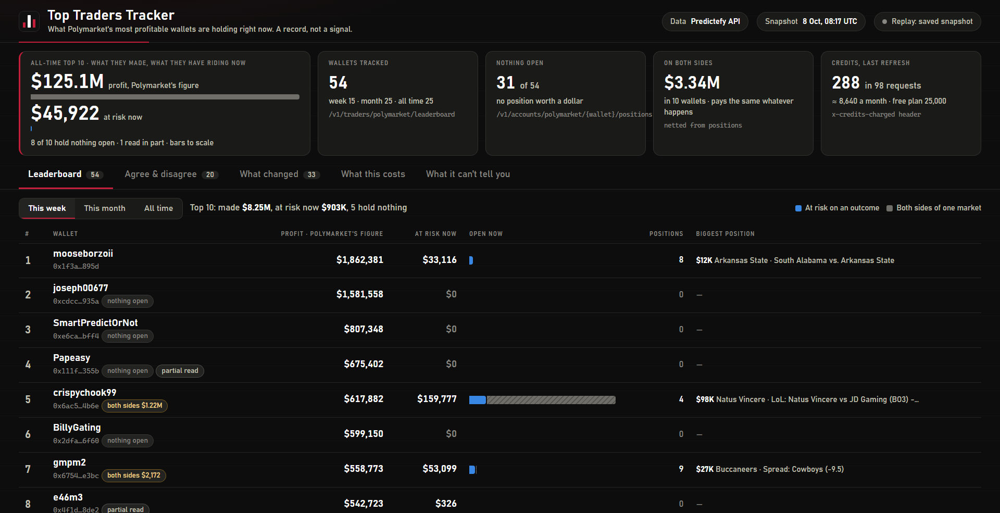

# Polymarket Top Traders Tracker

A small, read-only bot that reads Polymarket's profit leaderboards and shows what the wallets on them are holding right now: what they paid, what it is worth, where they agree, where they sit on opposite sides, and what it would cost you to buy the same position today.

It runs on your own computer, uses the [Predictefy API](https://predictefy.com/en/api?utm_source=youtube&utm_medium=video&utm_campaign=top-traders-tracker&utm_content=github) for every number, and opens a local dashboard in your browser. It never places orders and never asks for a wallet key.



> A leaderboard is a record of bets that already paid. This shows what is riding now. It is a record, not a signal.

## What it does

1. Reads the week, month and all-time profit leaderboards through Predictefy.
2. Reads each wallet's open positions, 100 rows a page, up to 4 pages a wallet.
3. Nets out both-sides holdings. A wallet holding the same number of Yes and No shares in one market is not betting on it: each pair pays $1 whatever happens.
4. Lists outcomes that two or more tracked wallets hold, and markets where they hold opposite sides.
5. Runs a copy check on any position: the wallet's average entry, the live order book, what a buy of $1,000 would average, and a week of hourly prices.
6. Saves every refresh and shows what opened, grew, shrank and disappeared since the one before.

## Quick start

You need [Node.js](https://nodejs.org) 22 or newer and a Predictefy API key from [portal.predictefy.com/keys](https://portal.predictefy.com/keys). The free plan is enough.

```bash
git clone https://github.com/Ong-pogs/polymarket-top-traders-tracker
cd polymarket-top-traders-tracker
cp .env.example .env        # Windows PowerShell: Copy-Item .env.example .env
```

Open `.env`, paste your key after `PREDICTEFY_API_KEY=`, then start the tracker:

```bash
node bot/server.mjs
```

Open the address it prints, `http://127.0.0.1:8818`. There is nothing to install: the tracker uses only what ships with Node.

The first refresh takes about two minutes, because the tracker paces itself at 50 requests a minute (the free plan allows 60). After that it refreshes once every 24 hours while it is running. To refresh once and exit, for a scheduled task:

```bash
node bot/server.mjs --once
```

## What this costs to run

| | Requests | Credits each | Credits |
|---|---:|---:|---:|
| Leaderboards (week, month, all time) | 3 | 1 | 3 |
| Position pages, 100 rows each | about 95 | 3 | about 285 |
| **One refresh, 54 wallets** | **about 98** | | **about 288** |
| One copy check (order book 5 + price history 5) | 2 | | 10 |

Measured on 8 October 2026 with the default settings. The dashboard counts the real figure from the `x-credits-charged` header on every response.

| Plan | Credits a month | What fits |
|---|---:|---|
| Free, $0 | 25,000 | One refresh a day (about 8,640 a month), or one every 12 hours (about 17,280), with room left for copy checks |
| Builder, $48.88 a month | 500,000 | One refresh an hour (about 207,000 a month), and price history longer than 7 days |
| Pro, $149 a month | 5,000,000 | One refresh every 5 minutes |

If the key runs out of credits (`402 INSUFFICIENT_CREDITS`) or asks for something the plan does not include (`403 PLAN_REQUIRED`), the tracker stops the refresh and shows a link to [Predictefy's plans](https://predictefy.com/en/pricing?utm_source=youtube&utm_medium=video&utm_campaign=top-traders-tracker&utm_content=github).

## Build it yourself

If you would rather have an AI coding tool write the tracker from scratch, [`build-prompt.txt`](build-prompt.txt) is the full specification: the endpoints, the netting rule, the copy check and the dashboard. Paste it into your AI coding tool in an empty folder.

## Endpoints used

| What | Predictefy endpoint | Credits |
|---|---|---:|
| Leaderboards | `GET /v1/traders/polymarket/leaderboard?by=profit&window=week\|month\|all&limit=…` | 1 |
| Open positions | `GET /v1/accounts/polymarket/{wallet}/positions?limit=100&cursor=…` | 3 a page |
| Live order book | `GET /api/polymarket/fetchOrderBook?outcomeId=…&limit=50` | 5 |
| Price history | `GET /api/polymarket/fetchOHLCV?outcomeId=…&resolution=1h&start=…&end=…` | 5 |

Position rows carry the normalized fields at the top level (`size`, `avgEntryPrice`, `markPrice`, `unrealizedPnl`) and the market's title and outcome under `raw`. Rows come back ordered by share count, largest first.

To see the raw rows the tracker reads:

```bash
node bot/peek.mjs board            # one row of the all-time leaderboard
node bot/peek.mjs book <handle>    # one position row of a wallet on the boards
```

## Settings

Change these on the dashboard's **What this costs** tab.

| Setting | Default | What it does |
|---|---|---|
| Refresh every | 24 hours | How often the boards and positions are read again |
| Wallets from each board | 15 week, 25 month, 25 all time | Up to 100 from each. Wallets on more than one board are read once |
| Pages of positions per wallet | 4 | 3 credits a page. A wallet with more rows is labelled partial |
| Requests a minute | 50 | The free plan allows 60 |
| Smallest position that counts | $5,000 | For agree, disagree and what changed |
| Copy check size | $1,000 | The buy that is priced against the live order book |
| Price history in the copy check | 7 days | The free plan reads 7 days |

Optional environment variables: `TRACKER_PORT` (default `8818`), `TRACKER_DATA` (default `data`) and `TRACKER_REPLAY=1`, which shows your saved snapshots without reading anything, so looking at them costs no credits.

## What it cannot tell you

- **A wallet is not a person.** The leaderboard ranks wallets. One trader can use several, so an empty wallet does not mean an empty trader.
- **Profit is Polymarket's number.** Ranks and profit come from Polymarket's board through Predictefy. The tracker does not recompute them.
- **Big wallets are read in part.** A wallet with thousands of small rows is read up to the page limit and labelled partial. Rows come largest first, so each unread position is no bigger than the last one read, and the dashboard says how big that is.
- **Average entry can mislead** in events with several outcomes, where shares can be created or converted without a trade. Those rows are labelled. Trust the plain yes-or-no markets more.
- **It shows what they hold, not when they will sell.** A position row has an average price and no date.
- **"Gone" is not always "sold".** A position that disappears was either sold or settled at zero. The tracker cannot tell which.

Nothing here is financial advice.

## Tests

```bash
node --test
```

## License

MIT. See [LICENSE](LICENSE).
